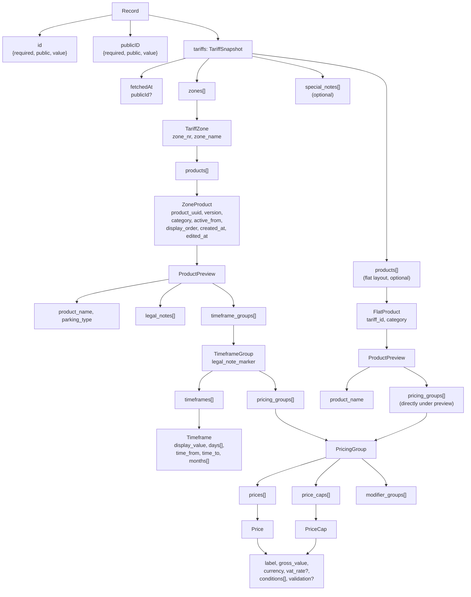

# Contipark

Contipark provides a JSON REST API (`/v1/carparks`) with static parking site data across Germany. Access
requires a certificate (`PARK_API_CONTIPARK_CERT_PATH`). The response contains a `data` list, where
each entry is one parking site. The API models only static data.

As car parks in the API have only the coordinates and addresses of the gates and not from the car park itself, the first gate is used for address and coordinates of the hole car_aprk, as there needs to be at least one gate.

A feature with parkingSpots for motorcycles or bikes greater than zero describes two to three installations at the same location: the bike
stands and motorcycle parkingSpots. As both have their own type and capacity, they are mapped to two separate
`ParkingSite`s, see [Bikes](#bikes) and [Motorcycle](#motorcycles).

Static values:

* `has_realtime_data` is always `False` (the API does not offer realtime data yet)
* `purpose` is set to `CAR`, if bike or motorcycle parkingspots are available, a separate ParkingSite is created for each of them

## ParkingSites

| Field                                           | Type                                      | Cardinality | Mapping                | Comment                                                       |
|-------------------------------------------------|-------------------------------------------|-------------|------------------------|---------------------------------------------------------------|
| publicID["value"]                               | string                                    | 1           | original_uid           |                                                               |
| consumerManagement["mcpUrl"]["value"]           | string (url)                              | ?           | public_url             |                                                               |
| gates[0]["street"]["value"]                     | str                                       | 1           | address                |                                                               |
| gates[0]["houseNumber"]["value"]                | str                                       | 1           | address                |                                                               |
| gates[0]["zipCode"]["value"]                    | str                                       | 1           | address                |                                                               |
| consumerManagement["mcpDescriptionDE"]["value"] | str                                       | 1           | description            |                                                               |
| type["value"]                                   | [ParkingSiteType](#parkingsitetype)       | 1           | type                   |                                                               |
| type["value"]                                   | [is_covered](#is_covered)                 | 1           | is_covered             |                                                               |
| namePublicDE["value"]                           | string                                    | 1           | name                   |                                                               |
| namePublicEN["value"]                           | string                                    |             |                        | ignored                                                       |
| dimensions["height"]["value"]                   | Number                                    | 1           | max_height             |                                                               |
| dimensions["width"]["value"]                    | Number                                    | 1           | max_width              |                                                               |
| bahnPark["isBahnPark"]                          | [ParkAndRideType](#parkandridetype)       | 1           | park_and_ride_type     |                                                               |
| tags["locations"]["value"]                      | string                                    | ?           | related_location       |                                                               |
| openingHours                                    | object                                    | 1           | opening_hours          | requires custom conversion logic based on the provided format |
| parkingSpots["total"]["value"]                  | int                                       | 1           | capacity               |                                                               |
| tags                                            | object                                    | 1           | tags                   |                                                               |
| gates[0]["lat"]["value"]                        | Number                                    | 1           | lat                    |                                                               |
| gates[0]["lon"]["value"]                        |                                           | 1           | lon                    |                                                               |
| parkingSpots                                    | [ParkingRestriction](#parkingrestriction) | 1           | restrictions           |                                                               |
| static_data_updated_at                          | str(date-time)                            | 1           | static_data_updated_at |                                                               |

### ParkingSiteType

| Key | Mapping: type             |
|-----|---------------------------|
| PD  | CAR_PARK                  |
| PH  | CAR_PARK                  |
| PP  | OFF_STREET_PARKING_GROUND |
| TG  | UNDERGROUND               |

### is_covered

| Key | Mapping: is_covered       |
|-----|---------------------------|
| PD  | false                     |
| PH  | true                      |
| PP  | false                     |
| TG  | true                      |

### parkandridetype

| Key | Mapping: park_and_ride_type |
|-----|-----------------------------|
| true| TRAIN                       |

### ParkingRestriction

| Key          | Mapping: restrictions.type   |
|--------------|------------------------------|
| women        | WOMEN                        |
| disabled     | DISABLED                     |
| motorhome    | CARAVAN                      |
| xxl          |                              |
| bahnComfort  |                              |
| mini         |                              |
| bus          | BUS                          |
| motorcycle   |                              |
| shortTerm    |                              |
| bicycle      |                              |
| pcardService |                              |
| motherChild  | FAMILY                       |
| truck        | TRUCK                        |
| senior       |                              |

## Bikes

If `parkingSpots["bicycle"]["value"]` is greater than zero, the feature additionally describes bike-parking at the
same location. They are mapped to a second `ParkingSite` which shares all attributes of the surrounding installation,
with the following exceptions:

| Field        | Mapping                                                                                     |
|--------------|---------------------------------------------------------------------------------------------|
| uid          | `{OBJECTID}-bikes`, to keep it unique against the `ParkingSite` for cars                    |
| name         | `{Name} (Fahrräder)`, to distinguish both sites at the same coordinates                     |
| purpose      | Always `BIKE`                                                                               |
| capacity     | parkingSpots["bicycle"]["value"]`                                                           |

## Motorcycles

If `parkingSpots["motorcycle"]["value"]` is greater than zero, the feature additionally describes bike-parking at the
same location. They are mapped to a second `ParkingSite` which shares all attributes of the surrounding installation,
with the following exceptions:

| Field        | Mapping                                                                                     |
|--------------|---------------------------------------------------------------------------------------------|
| uid          | `{OBJECTID}-motorcycle`, to keep it unique against the `ParkingSite` of the cars            |
| name         | `{Strasse} (Motorrad)`, to distinguish both sites at the same coordinates                   |
| type         | Always `MOTOCYCLE`                                                                          |
| capacity     | `parkingSpots["motorcycle"]["value"]`                                                       |

## Tariffs

Fields are described as properties of the returned tariff objects in the data list.

* `currency` is always set to `EUR`
* `tax_rate` is always set to `0.19`
* `updated_at` is set to the import date time

| Field          | Type                           | Cardinality | Mapping | Comment |
|----------------|--------------------------------|-------------|---------|---------|
| publicID.value | str                            | 1           | uid     |         |
| zones          | [TariffOptions](#tariffoption) | +           | options |         |

## TariffOption

| Field    | Type                                 | Cardinality | Mapping    | Comment |
|----------|--------------------------------------|-------------|------------|---------|
| products | [TariffComponents](#tariffcomponent) | +           | components |         |

## TariffComponent

| Field | Type | Cardinality | Mapping | Comment |
|-------|------|-------------|---------|---------|

The supplied `tariffs.json` is a paginated response. Each `data` entry identifies a
parking site and contains a `tariffs` snapshot. The diagram shows the observed JSON
structure, including both product layouts present in the supplied response (250
records returned; 548 reported in total).

In the supplied page, every record has `id`, `publicID`, and `tariffs`; `tariffs.zones`
is present but can be empty. Some snapshots also use a top-level `products` array
rather than placing products under zones; those previews have `pricing_groups`
directly and an empty `timeframe_groups`.
Zone products use `timeframe_groups`, which contain both `timeframes` and
`pricing_groups`. Optional fields and array sizes in the diagram describe the supplied
response, not guaranteed API-wide constraints. Amounts such as `gross_value` are
integers and `currency` is a string (observed as `EUR`).
